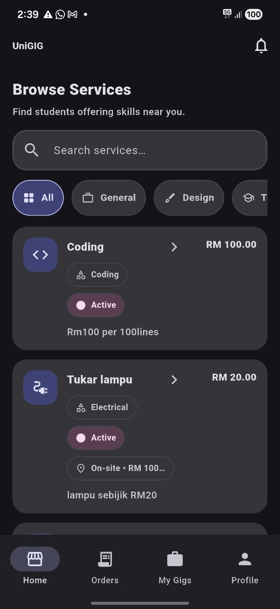
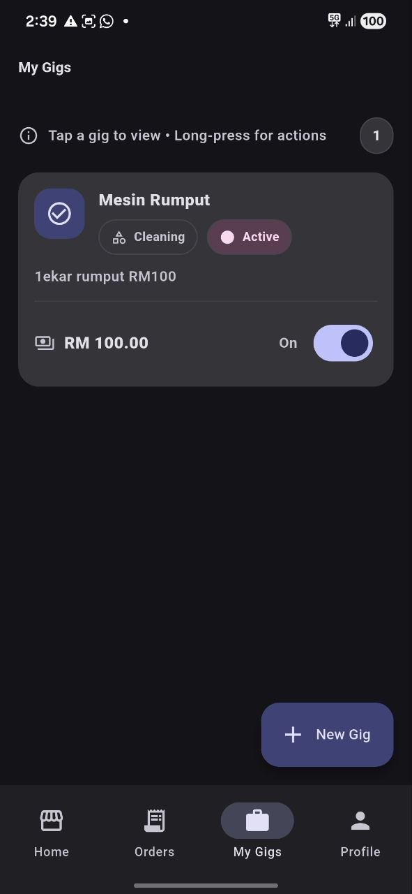
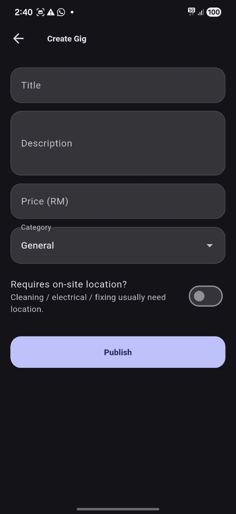

# UniGIG

**A mobile marketplace where university students offer and book freelance services.**

UniGIG connects student sellers (tutoring, design, coding, video editing, writing, cleaning, electrical work) with buyers on campus. Sellers publish gigs, buyers place orders, and each order moves through a tracked lifecycle: deposit, delivery with proof, completion and rating. Location-based services calculate a transport charge from the distance between buyer and seller.

Built with **Flutter** and **Firebase**.

## Screenshots

<p align="center">
  
  
  
  
</p>

## Features

**For sellers**
- Create, edit, activate or deactivate and delete gigs, with a category, price and description
- Upload a payment QR code per gig and set a deposit amount
- Set a service location and a transport rate per kilometre for on-site services
- Accept or reject orders, verify the buyer's deposit receipt, then start work and mark delivery with a proof photo

**For buyers**
- Browse and search gigs, filtered by category
- See a live price preview, including transport charge, before ordering
- Pay a deposit by scanning the seller's QR code and upload the receipt
- Confirm completion and leave a 1 to 5 star review

**For everyone**
- Email and password sign up and login
- In-app notifications for new orders, acceptance, deposit decisions, delivery and ratings
- Profile photos, public seller reviews, and light and dark themes

## How an order works

```
Buyer places order ──► pending
                          │  (deposit gigs: buyer uploads receipt ──► seller verifies)
                          ▼
                      accepted ──► in_progress ──► delivered (proof photo) ──► completed ──► rated
                          │
              rejected / cancelled
```

Deposit payments have their own states: `AWAITING_RECEIPT`, `PENDING_VERIFICATION`, `VERIFIED` and `REJECTED`. Status changes, ratings and payment verification run in Firestore transactions. Only the buyer can rate a completed order (once), and only the seller can verify a deposit.

## Transport pricing

For gigs that require a visit, the app reads the buyer's GPS position, converts it to an address, and computes the distance to the seller with the Haversine formula:

```
total = service price + (distance in km × seller's rate per km)
```

## Tech stack

| Area | Technology |
|---|---|
| Framework | Flutter (Dart 3) |
| State management | Riverpod |
| Navigation | go_router, with an authentication guard |
| Backend | Firebase Authentication, Cloud Firestore, Firebase Storage |
| Location | geolocator, geocoding |
| Media | image_picker |
| Other | shared_preferences, intl |

## Project structure

```
lib/
├── main.dart               App entry point and theme setup
├── core/router/            Routes and auth redirect
├── features/               Auth, deposit payment, settings
├── gigs/                   Create, edit, list and view gigs
├── orders/                 Order list, status actions, rating
├── home/                   Home shell and gig browsing
├── profile/                Profile and seller reviews
├── services/               Firebase access (auth, gigs, orders, storage, users)
└── theme/                  Light and dark themes
```

## Getting started

**Requirements:** Flutter SDK (Dart ^3.10.4), an Android emulator or device, and a Firebase project.

```bash
git clone https://github.com/uthmanaffan4578-dot/UniGIG-MobileApp.git
cd UniGIG-MobileApp
flutter pub get
flutter run
```

To use your own backend, create a Firebase project, enable Email/Password sign-in, Firestore and Storage, then run `flutterfire configure` to regenerate `lib/firebase_options.dart` and `android/app/google-services.json`.

## Roadmap

- Online payment through a payment gateway instead of manual QR receipts
- In-app chat between buyer and seller
- Push notifications
- Automated tests

## Author

**Uthman 'Affan** · Computer Science (Multimedia Computing), UTHM
[GitHub](https://github.com/uthmanaffan4578-dot) · [LinkedIn](https://linkedin.com/in/uthman-affan)
